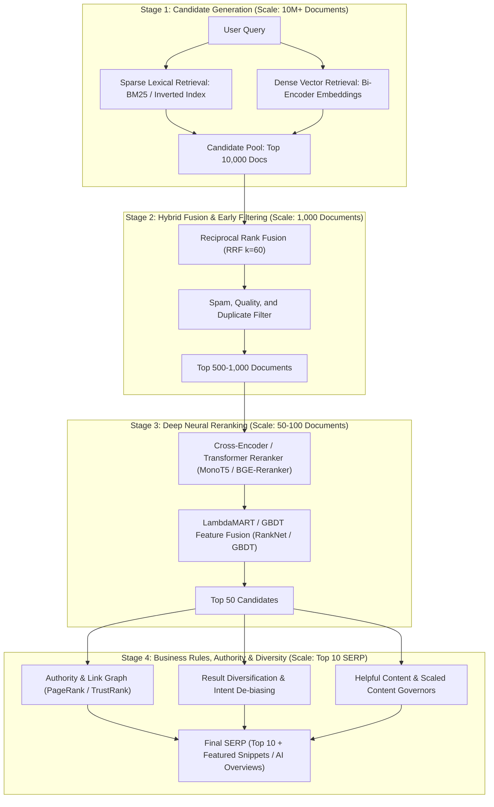
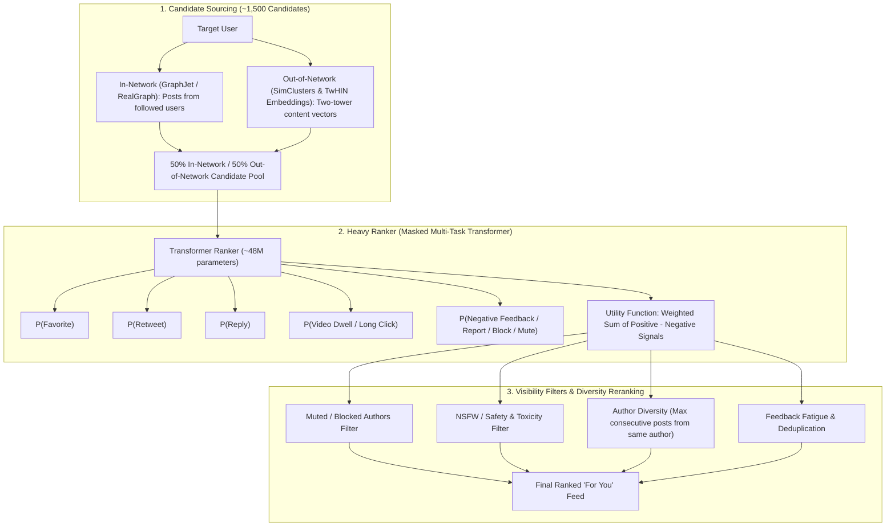
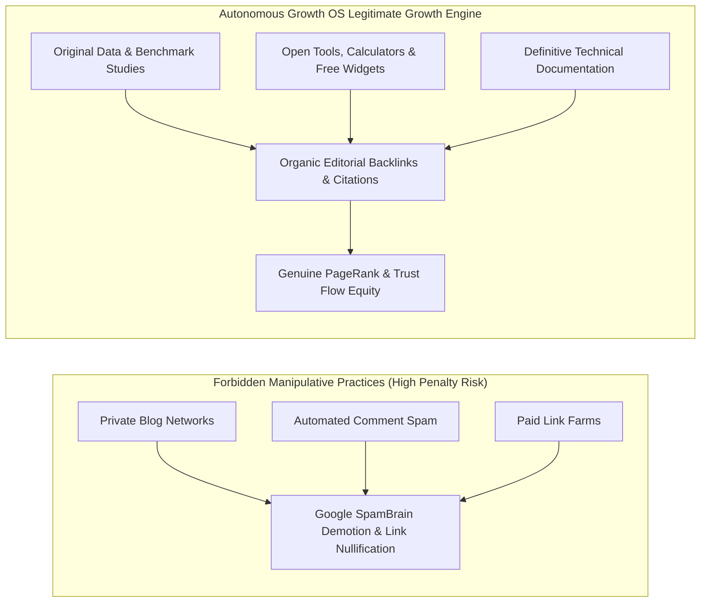

# Algorithm & Repository Atlas: Search Systems, Social Feeds & Discovery Mechanics
**Autonomous Growth OS — Frontier Algorithm Intelligence & Deep-Tech Reference**  
**Document version:** 1.0.0  
**Snapshot date:** 13 October 2026  
**Classification:** Research, Engineering Blueprint, and Operational Guide

---

## Executive Summary & Core Doctrine

The Autonomous Growth OS exists to solve a fundamental challenge in growth engineering: acquiring genuine, sustained, high-intent human attention across search engines, social feeds, and digital communities without resorting to spam, black-hat tricks, or fragile hacks.

### The "Algorithm Intelligence" Philosophy
Modern digital platforms are governed by complex mathematical ranking pipelines. To build an autonomous growth system that reliably achieves discovery:
1. **Never claim private reverse-engineering or inside access:** We do not claim access to proprietary internal weights, secrets, or undocumented internals.
2. **Operate from verifiable foundations:** We rely on officially documented API specs, peer-reviewed machine learning literature, public open-source implementations (e.g. `xai-org/x-algorithm`), and controlled, empirical experiments.
3. **Respect quality governors:** Platforms (Google, Meta, LinkedIn, X, YouTube) optimize for user retention, satisfaction, and utility. Attempting to spam or game them with shallow, programmatic AI text results in catastrophic de-indexing (Google Scaled Content Abuse policy) or algorithmic shadowbans. Real growth requires engineering assets that genuinely satisfy the algorithms' optimization objective functions.

---

## 1. Search Engine Retrieval & Ranking Mechanics

### 1.1 Multi-Stage Search Architecture
Modern web search engines (Google, Bing, Perplexity, You.com) do not execute a single monolithic ranking model across billions of web pages. They employ a multi-stage funnel designed to balance computational latency (sub-100ms response time) against semantic ranking quality.

### 1.2 Algorithmic Components Explained
- **BM25 (Best Matching 25):** Probabilistic lexical retrieval measuring term frequency (TF) and inverse document frequency (IDF) with document length normalization parameters ($k_1 \approx 1.2 - 2.0$, $b \approx 0.75$). BM25 excels at exact keyword matching, technical identifiers, product codes, and rare vocabulary, but fails on lexical mismatch (synonyms, paraphrase).
- **Dense Vector Retrieval (Bi-Encoders):** Maps query $q$ and document $d$ into dense semantic vector space $\mathbb{R}^d$ via separate encoder towers, computing similarity as $\cos(\mathbf{e}_q, \mathbf{e}_d)$. Dense retrieval captures semantic intent and paraphrasing, but suffers from "hallucinated relevance" on rare acronyms or numerical thresholds.
- **Reciprocal Rank Fusion (RRF):** Merges disparate rank lists $R_{sparse}$ and $R_{dense}$ without requiring calibrated score normalization:
  $$RRF(d) = \sum_{m \in M} \frac{1}{k + r_m(d)}$$
  where $k = 60$ is the standard smoothing parameter, and $r_m(d)$ is the 1-based rank of document $d$ in model $m$.
- **Cross-Encoder Reranking:** Computes full cross-attention between concatenated query and document tokens $[CLS] \circ q \circ [SEP] \circ d$. Cross-encoders capture intricate syntactic nuance, negation, and token interactions that bi-encoders miss.
- **LambdaMART & GBDT Scoring:** Combines neural scores, lexical scores, historical click-through rates (CTR), dwell time / long-click signals, and domain authority features into an optimized pairwise loss function optimizing NDCG.
- **PageRank & Authority Graph:**
  $$\mathbf{r} = d \mathbf{M} \mathbf{r} + \frac{1-d}{N} \mathbf{1}$$
  Link equity acts as a prior probability distribution over page importance. Modern search engines combine topical PageRank with editorial seed-set TrustRank to neutralize link networks (PBNs).

### 1.3 Search Intent Taxonomy & Algorithm Suitability
| Query Intent | User Objective | Algorithmic Signals Favored | OS Asset Strategy |
|---|---|---|---|
| **Informational** | Understand a concept, solve an issue | Comprehensive coverage, clear entity hierarchy, schema markup, high source attribution | Deep explanatory guides, interactive calculators, technical docs |
| **Navigational** | Find a specific brand, tool, or login | Exact match domain, branded anchor text, sitelinks | Branded landing pages, canonical brand identity pages |
| **Commercial Investigation** | Compare solutions, read reviews, evaluate specs | Comparison tables, pros/cons, neutral tone, pricing transparency | Objective benchmark matrices, feature comparisons, teardowns |
| **Transactional** | Purchase, subscribe, sign up | Fast page load, secure forms, clear CTA, pricing schemas | High-converting landing pages with frictionless onboarding |

### 1.4 Google Policy Guardrails (Enforced in Quality Governor)
- **Scaled Content Abuse (March 2024 Core Update & 2026 Guidelines):** Mass-producing low-value programmatic pages using generative AI without substantial human editorial validation or original research triggers manual domain actions and automated demotion.
- **Site Reputation Abuse:** Publishing third-party content on established domains with low oversight to exploit first-party ranking power is penalized.
- **Helpful Content System (Continuous Classifier):** Assesses whether content was created primarily for search engine rankings rather than to assist humans. Indicators of unhelpful content: repetitive AI phrasing, summarizing other articles without original data, lack of first-hand experience, clickbait titles that leave questions unanswered.

---

## 2. Social Recommendation Algorithms

### 2.1 The X (Twitter) Recommendation Algorithm (`xai-org/x-algorithm` Reference)
Based on public code releases and technical publications from X (`xai-org/x-algorithm`), the "For You" feed employs a multi-tiered pipeline:

#### Key Quantitative Takeaways from the X Algorithm:
1. **Engagement Weighting:** Positive interactions carry distinct mathematical weights:
   - Retweets / Reposts: High network distribution multiplier.
   - Reply conversations (author responding to commenter within 1 hour): Massive conversation graph bonus.
   - External links without media or native engagement: Historically penalized or subject to lower baseline distribution unless the post drives long conversation threads.
2. **Negative Signal Multipliers:** Muting, blocking, reporting, or "show less often" clicks incur severe negative score multipliers (typically $10\times$ to $100\times$ the value of a favorite), causing immediate algorithmic suppression.
3. **SimClusters & TwHIN:** Posts are mapped to interest clusters based on overlapping follower graphs. Content must fit tightly into identifiable topical communities rather than being broadcast as generic text.

### 2.2 LinkedIn Feed Algorithm (March 2026 Engineering Findings)
LinkedIn's feed prioritizes professional knowledge sharing, workplace relevance, and peer conversation over viral superficiality. Recent engineering disclosures detail:

- **Sequential Feed Ranking:** Uses transformer-based sequential models (similar to SASRec / BERT4Rec) to predict a member's multi-step session trajectory rather than isolated point-wise item clicks.
- **LLM-Based Semantic Retrieval:** Augments traditional keyword graphs with dense LLM embeddings trained on industry taxonomies and professional skills.
- **Creator-Consumer Marketplace Balance:** Prevents top creators from monopolizing the entire feed; enforces a Gini coefficient ceiling so that niche, professional practitioners receive guaranteed distribution to their relevant skill network.
- **Knowledge & Advice Classifier:** Explicitly scores posts for:
  - First-person experiential knowledge ("Here is what we tested in production" vs generic generic advice).
  - Meaningful comments (comments longer than 15 words by verified professionals in the subject domain carry $5\times$ weight compared to simple reaction emojis).
  - Document Carousels & In-depth Text: Long dwell-time formats receive highest engagement multipliers.

### 2.3 Meta / Instagram Recommendation Engines
Meta's recommendation architecture (powering Facebook Reels and Instagram Explore/Reels) operates via:
1. **Two-Tower Deep Learning:** User tower encodes user history, active interests, and demographic context; Item tower encodes video multimodal embeddings (visual frames, audio track, transcript).
2. **Reels Exploration vs Exploitation Bandit:**
   - Cold-start: New reels are served to a small test cohort of 100-500 hyper-targeted users.
   - Completion Rate & Re-watch Rate: If completion rate $> 60\%$ and share-to-view ratio is high, the content escalates to Tier-2 distribution (5,000-20,000 users).
   - Drop-off Penalty: If initial cohort skips before second 3, the video is pruned from recommendation exploration.

### 2.4 YouTube & TikTok Video Algorithms
- **YouTube:** Primary signals are Click-Through Rate (CTR) and Average Percentage Viewed (APV) / Absolute Watch Time. Long-form video favors overall session watch time; YouTube Shorts favors completion percentage ($>85\%$) and loop replays.
- **TikTok:** Iterative tiered distribution loops driven almost exclusively by completion rate, comment thread engagement, and outbound shares.

---

## 3. Algorithm Suitability Matrix: Formats vs Channels

To prevent mismatched content distribution, the Autonomous Growth OS enforces the following channel-format compatibility rules:

| Content Format | Primary Channel | Algorithmic Success Factor | Disqualification / Penalty Triggers |
|---|---|---|---|
| **Deep Technical Article** | Organic Search / Blog | Comprehensive entity coverage, original benchmarks, clear schema markup | Thin AI summarization, lack of original sources, high keyword stuffing |
| **Interactive Widget / Tool** | Search & Referral | High dwell time, repeat visits, organic editorial backlinks | Slow load time, mobile unfriendliness, interstitial walls |
| **Document Carousel (PDF)** | LinkedIn | High swipe dwell time, actionable step-by-step framework | Generic marketing bullet points, poor visual contrast |
| **Conversational Hook & Thread** | X (Twitter) | High reply volume, author responses within 60 min, bookmark saves | Isolated link without context, external spam, copy-paste bot templates |
| **Short-Form Video Script** | YouTube Shorts / Reels | Immediate visual/auditory hook within 2.5s, loop structure, high completion rate | Slow narrative buildup, low energy audio, misleading clickbait title |
| **Community Contribution** | Reddit / Hacker News | High technical rigor, humility, transparency, zero self-promotional spam | Direct affiliate links, promotional copy, disguised advertisements |

---

## 4. Link Graph Diagnostics & Authority Modeling

### 4.1 Safe, Legitimate Authority Building vs Manipulative Schemes
The Autonomous Growth OS strictly forbids Private Blog Networks (PBNs), automated comment spam, paid link directories, and reciprocal link rings.

### 4.2 Link Asset Hook Architecture
The OS prioritizes three categories of **link-earning assets**:
1. **Industry Benchmark Reports:** Compiling anonymized industry metrics or technical benchmarks that journalists, analysts, and bloggers cite as primary sources.
2. **Utility Micro-Tools:** Interactive ROI calculators, schema generators, and diagnostic tests that naturally earn editorial bookmarks and directory listings.
3. **Comprehensive Topic Atlases:** Unrivaled, structured references that serve as canonical educational resources.

---

## 5. Confidence Taxonomy: Knowledge Provenance

Every insight, rule, and optimization policy maintained in the Autonomous Growth OS must carry an explicit knowledge classification:

1. `[OFFICIALLY_DOCUMENTED]`: Verified through official platform engineering documentation, developer APIs, search quality guidelines, or patent filings (e.g. Google Search Essentials, LinkedIn Engineering Blog, X Algorithm GitHub repo).
2. `[RESEARCH_SUPPORTED]`: Backed by peer-reviewed machine learning research (e.g. Reciprocal Rank Fusion, BM25, LambdaMART, two-tower neural architectures).
3. `[EMPIRICALLY_OBSERVED]`: Statistically validated across controlled A/B test experiments run by the OS, with recorded confidence intervals and sample sizes.
4. `[HYPOTHESIS_PENDING_TEST]`: Theoretical optimization idea currently in queue for controlled empirical experimentation. Never treated as established fact.

---

## 6. Implementation Architecture in Autonomous Growth OS

The Algorithm Atlas connects directly to the core operating system through three components:
1. **`OpportunityScoringEngine`:** Incorporates search intent classification, competition index, and algorithm feasibility into candidate opportunity selection.
2. **`QualityGovernor`:** Enforces platform-specific quality rubrics (e.g. Google Scaled Content resistance, LinkedIn professional tone, X conversational density) before passing content to the Human Approval Queue.
3. **`algorithm-lab` Benchmark Package:** Provides an offline testing harness to measure ranking precision (NDCG, MRR) and evaluate hybrid retrieval performance before deploying scoring updates to production.
